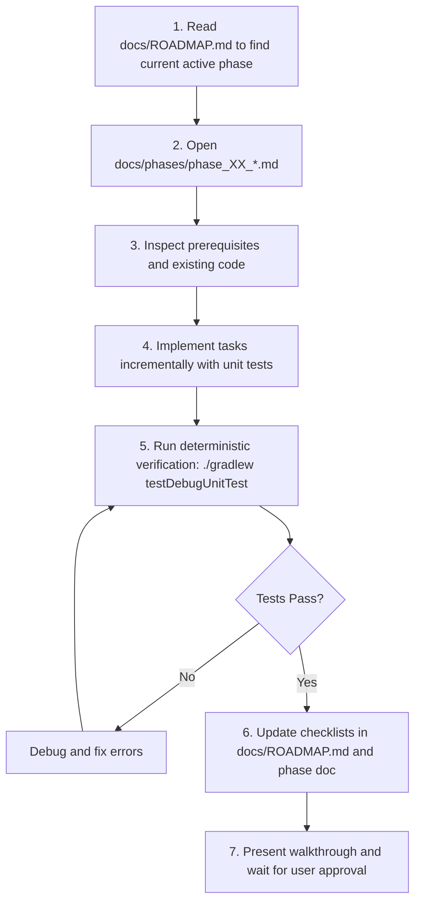

# Agent Operating Manual & Engineering Standards

> **Notice for Autonomous AI Coding Agents:**  
> This project follows strict **Agentic Engineering Best Practices**. When you are assigned a task on this repository, you must read and adhere to the protocols established in this document.

---

## 1. Core Principles of Agentic Engineering

### 1.1 Spec-Driven Development
* Do not invent architecture or requirements on the fly.
* All requirements, data schemas, API contracts, and design decisions are specified in `docs/PRD.md`, `docs/architecture/`, and `docs/features/`.
* When ambiguity arises, resolve it by reading the specifications or requesting clarification from the user rather than guessing.

### 1.2 One Phase at a Time (Staged Execution)
* **Never attempt to implement the entire project or multiple phases in a single prompt.**
* Always inspect `docs/ROADMAP.md` to identify the current active phase.
* Open the corresponding phase document (`docs/phases/phase_XX_*.md`).
* Complete only the tasks defined in that phase.
* Verify your implementation against the phase acceptance criteria and automated tests.
* Update the phase checklist in `docs/ROADMAP.md`.
* **STOP** and report your progress to the user for human-in-the-loop review before proceeding.

### 1.3 Strict Testability (TDD & Verification)
* Every data model, algorithm, database DAO, and network client must have automated tests.
* Write unit tests for all edge cases (e.g., all 11 states in the 3-way sync reconciliation matrix).
* Use `MockWebServer` for network testing without hitting live cloud APIs.
* Verify code builds and tests pass cleanly using deterministic CLI commands before declaring a task complete.

### 1.4 Non-Destructive Data Safety
* This is a file synchronization application: **data loss is an unacceptable failure mode**.
* Always use atomic staging writes (`.sync_tmp` rename) when writing files to local disk.
* Never overwrite a file during a conflict; always branch into a distinct conflict copy.
* Wrap all database modifications in transactions.

---

## 2. Project Architecture & Standards

### 2.1 Technology Stack & Invariants
* **Language:** 100% Kotlin with explicit type signatures for public APIs.
* **Concurrency:** Kotlin Coroutines (`Dispatchers.IO` for file/network, `Dispatchers.Default` for CPU-heavy diffing, `Dispatchers.Main` for UI) with structured concurrency. Avoid `GlobalScope`.
* **Asynchronous Streams:** Kotlin `Flow` / `StateFlow` / `SharedFlow`.
* **Database:** Room with SQLite. All queries affecting sync state must run within transactions.
* **Networking:** OkHttp / Retrofit with custom interceptors for OAuth Bearer token injection and rate-limit handling.
* **UI:** Jetpack Compose + Material 3. Follow MVI / MVVM pattern with `ViewModel` and immutable UI state classes.
* **Security:** Use Android Keystore via `EncryptedSharedPreferences` for all tokens and secrets. Never log tokens or raw credentials.

### 2.2 Standard Development Commands

Run all commands from the repository root:

```bash
# Run all unit tests
./gradlew testDebugUnitTest

# Run unit tests for a specific package/class
./gradlew testDebugUnitTest --tests "com.example.android_sync_idea.sync.*"

# Assemble debug APK
./gradlew assembleDebug

# Run static analysis / lint
./gradlew lintDebug
```

---

## 3. How an Agent Should Execute a Phase

When instructed to *"implement the next phase"* or *"continue the project"*:



### Protocol Checklist for the Agent:
1. **Read Context:**
   * Read `docs/ROADMAP.md`.
   * Read the active phase file in `docs/phases/`.
   * Read any referenced feature specifications in `docs/features/`.
2. **Execute Incrementally:**
   * Implement models, interfaces, and business logic before UI.
   * Add unit tests alongside each component.
3. **Verify:**
   * Execute `./gradlew testDebugUnitTest`.
   * Ensure zero compilation warnings or test failures.
4. **Update Tracking:**
   * Mark completed checklist items with `[x]` in the phase document and `docs/ROADMAP.md`.
5. **Report to User:**
   * Detail what was created/modified, the test outcomes, and what the next phase will cover.
   * **Wait for user confirmation.**

