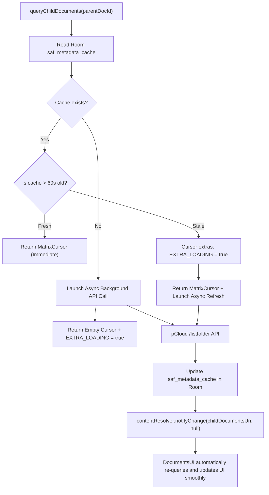

# Architecture Guide: Storage Access Framework & `DocumentsProvider`

---

## 1. The Storage Access Framework (SAF) Model

Introduced in Android 4.4 (KitKat) and expanded in Android 5.0–15, the **Storage Access Framework (SAF)** allows cloud storage providers to appear alongside local storage and USB drives in Android's native system file picker (`DocumentsUI`).

When an app invokes `Intent.ACTION_OPEN_DOCUMENT` or `Intent.ACTION_CREATE_DOCUMENT`, Android launches the system file picker. The system picker queries all registered `DocumentsProvider` instances via Android Binder IPC to render storage roots and folder hierarchies.

---

## 2. IPC Lifecycle & Concurrency Pitfalls

```
Calling App (e.g. Acrobat) ───[IPC]───> Android DocumentsUI ───[IPC]───> CloudDocumentsProvider
```

### The UI Thread Latency Trap
* The methods `queryRoots()`, `queryDocument()`, and `queryChildDocuments()` are invoked synchronously by Android's `DocumentsUI`.
* If a `DocumentsProvider` executes a blocking network HTTP request inside `queryChildDocuments()` that takes $>2\text{ seconds}$, the system file picker stutters, drops frames, or prompts an **Application Not Responding (ANR)** error.
* **Architecture Rule:** Network calls must **never** run synchronously inside query methods.

---

## 3. The Non-Blocking SQLite Metadata Cache Pattern

To ensure 60 FPS scrolling and instant folder navigation in the system picker:



1. **Step 1:** Query `saf_metadata_cache` table in Room SQLite.
2. **Step 2:** Populate a `MatrixCursor` with cached children.
3. **Step 3:** If cache is older than 60 seconds (or missing), attach the `DocumentsContract.EXTRA_LOADING` bundle extra and return the cursor immediately. The system picker displays a progress spinner at the top of the view.
4. **Step 4:** Launch an asynchronous Coroutine to query pCloud's `listfolder` endpoint.
5. **Step 5:** Write remote results to SQLite and invoke `contentResolver.notifyChange(childUri, null)`.
6. **Step 6:** Android's `DocumentsUI` automatically re-queries the provider and displays the newly refreshed folder contents without any UI lag.

---

## 4. `ParcelFileDescriptor` & Seekable Descriptors

### 4.1 The Pipe Limitation (`createPipe()`)
Standard tutorials suggest returning a pipe (`ParcelFileDescriptor.createPipe()`) where a background thread writes downloaded bytes into the pipe while the external app reads from it.
* **Why pipes fail for cloud files:**
  * Pipes are FIFO streams; they **do not support `lseek()`**.
  * Media players (VLC, ExoPlayer) seek to read container headers (MP4 `moov` atom at the end of the file).
  * PDF readers seek to read the trailer and cross-reference table (`xref`) at the end of the file.
  * Attempting to seek an unseekable pipe throws `ESPIPE` and causes the third-party app to crash.

### 4.2 On-Demand Disk Caching Solution
1. When `openDocument(documentId, "r", signal)` is called:
2. Check if the file is already cached in `context.cacheDir/saf_cache/${documentId}`.
3. If not cached, download the file from pCloud directly into the cache file, passing the Android `CancellationSignal` to abort download if the user dismisses the file picker.
4. Open the local file using:
   ```kotlin
   ParcelFileDescriptor.open(cachedFile, ParcelFileDescriptor.MODE_READ_ONLY)
   ```
5. Because the descriptor points to a physical disk file, it is fully seekable with zero compatibility issues.

---

## 5. Capturing External Saves via `OnCloseListener`

When a third-party application opens a cloud file in write mode (`"w"`, `"wa"`, `"wt"`, `"rw"`):
1. Allocate a local staging file in cache.
2. Return a `ParcelFileDescriptor` configured with Android's `OnCloseListener`:
   ```kotlin
   val pfd = ParcelFileDescriptor.open(
       stagingFile,
       ParcelFileDescriptor.MODE_READ_WRITE,
       handler
   ) { ioException ->
       if (ioException == null) {
           // External application has flushed and closed the file descriptor
           // Safely enqueue upload to pCloud
           CloudUploadWorker.enqueueUpload(context, documentId, stagingFile)
       }
   }
   return pfd
   ```
3. When the user taps "Save" in an external editor and the app closes the stream, the `OnCloseListener` triggers immediately in our process on the specified `Handler`.
4. The worker pushes the updated file to pCloud in the background.

