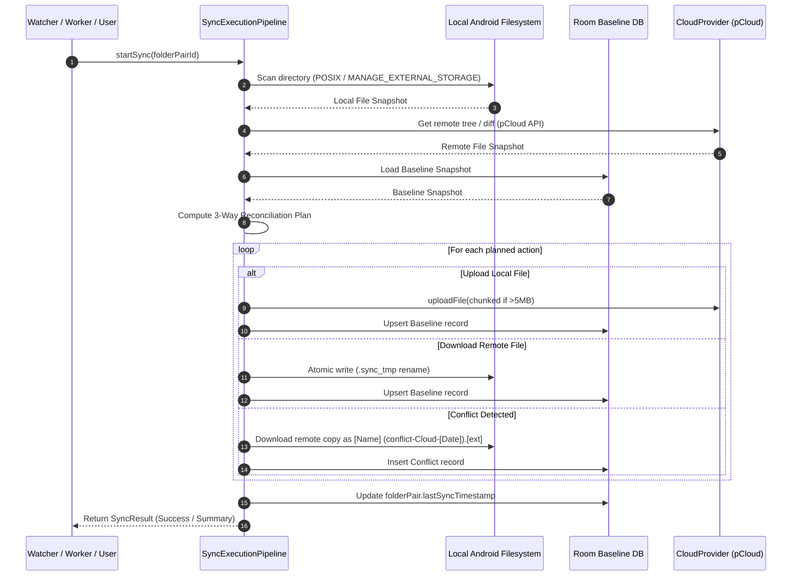
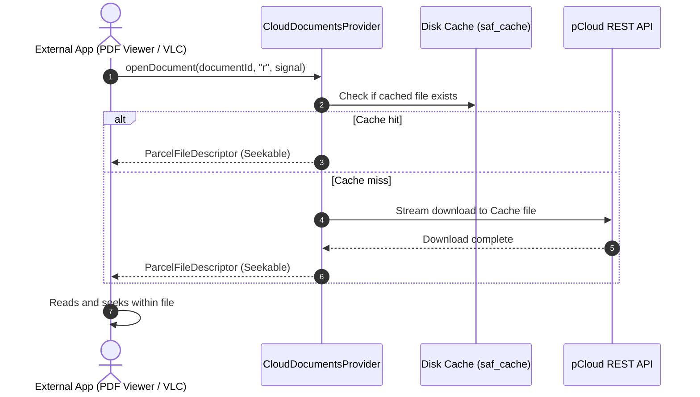

# System Architecture & Technical Specifications

---

## 1. Architectural Philosophy

CloudSync Android follows **Clean Architecture** combined with **Agentic Engineering Best Practices**:
* **Dependency Rule:** Source code dependencies point inward toward domain models and business logic. The core domain layer has zero dependencies on Android UI or network frameworks.
* **Separation of Concerns:** The network layer (`core:provider`), the database layer (`core:database`), the synchronization engine (`core:sync`), the virtual filesystem (`core:saf`), and the UI (`app`) are isolated packages/modules with explicit interface boundaries.
* **Immutable State & Reactive Streams:** Data state is exposed through Kotlin Coroutine `Flow` and `StateFlow`. UI components react to state rather than querying imperatively.

---

## 2. Layer & Module Overview

```
                      ┌─────────────────────────────────────────┐
                      │          UI Layer (Compose MVI)         │
                      │  Dashboard, Pairs, Conflicts, Settings  │
                      └────────────────────┬────────────────────┘
                                           │
                      ┌────────────────────▼────────────────────┐
                      │        Execution & Scheduling Layer     │
                      │  SyncWorker, SyncForegroundService      │
                      └──────────────┬──────────────────┬───────┘
                                     │                  │
        ┌────────────────────────────▼──┐    ┌──────────▼────────────────────┐
        │  Core Synchronization Engine  │    │  SAF DocumentsProvider        │
        │  3-Way Reconciler, Plan Exec  │    │  Virtual Drive & File Picker  │
        └──────────────┬────────────────┘    └──────────┬────────────────────┘
                       │                                │
                       ├────────────────────────────────┤
                       │                                │
        ┌──────────────▼────────────────┐    ┌──────────▼────────────────────┐
        │   Database & Storage Layer    │    │   Cloud Provider Layer        │
        │   Room (SQLite), Filesystem   │    │   pCloud REST, Generic WebDAV │
        └───────────────────────────────┘    └───────────────────────────────┘
```

### Module Responsibilities:
1. `core:model`: Immutable domain entities (`CloudAccount`, `CloudItem`, `SyncPair`, `SyncConflict`, `SyncResult`).
2. `core:database`: Room SQLite database entities, DAOs, and migrations (`AppDatabase`, `FolderPairDao`, `SyncBaselineDao`, `SyncConflictDao`).
3. `core:security`: Android Keystore integration and `EncryptedSharedPreferences` for token protection.
4. `core:provider`: `CloudProvider` interface contract and implementations (`PCloudProvider`, `WebDavProvider`).
5. `core:sync`: Fast content hashing (`xxHash64`), 3-way reconciliation state machine, non-destructive conflict branching, and atomic file writers.
6. `core:watcher`: Recursive Linux `inotify` file watcher (`FileObserver`) with Coroutine-based debouncing.
7. `core:work`: AndroidX `WorkManager` workers, background periodic scheduling, and Foreground Service management.
8. `core:saf`: Storage Access Framework `CloudDocumentsProvider`, local disk cache manager, seekable descriptors, and `OnCloseListener` upload pipeline.
9. `app`: Jetpack Compose Material 3 presentation layer.

---

## 3. Data Flow Pipelines

### 3.1 Two-Way Synchronization Pipeline



### 3.2 Virtual Drive On-Demand Read Pipeline (`DocumentsProvider`)



